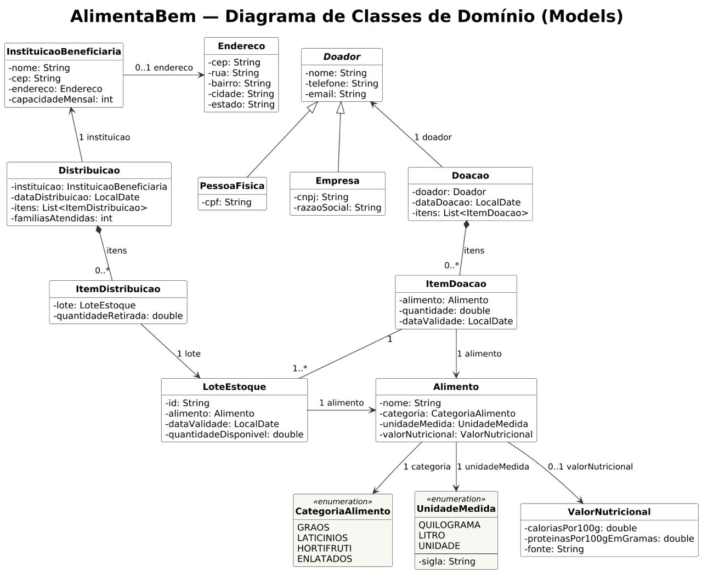
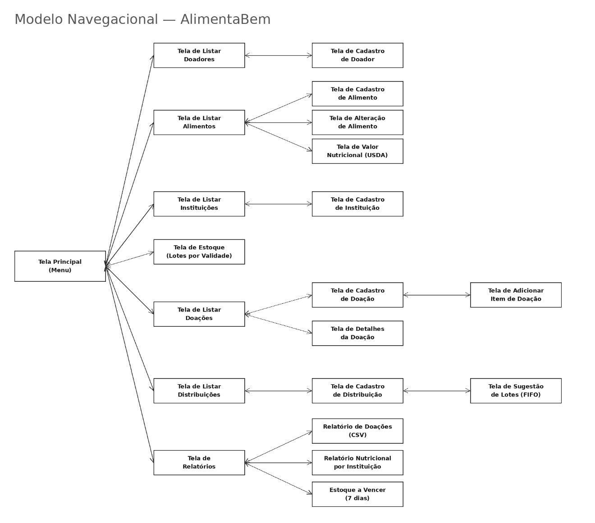

# Sistema AlimentaBem

## Descrição

Sistema para gestão de um banco de alimentos/ONG de doação, controlando doadores, doações recebidas, estoque de alimentos e sua distribuição para instituições beneficiárias. O sistema deve priorizar a distribuição de alimentos mais próximos do vencimento, evitando desperdício, e nunca permitir a distribuição de itens já vencidos.

Como diferencial, o sistema calcula o valor nutricional agregado de cada distribuição consultando uma base pública de composição de alimentos, e valida o endereço de coleta/entrega automaticamente a partir do CEP informado.

> **Nota:** a Tabela TACO (NEPA/UNICAMP) é distribuída apenas como planilha/PDF estático, sem nenhuma API REST oficial disponível — por isso não pode ser "consultada" em tempo real como as demais integrações deste conjunto de projetos. A sugestão abaixo usa a **USDA FoodData Central**, API pública e gratuita (chave de uso gratuito obtida em segundos) mantida pelo governo dos EUA, que cumpre o mesmo papel pedagógico de consulta a uma base nutricional real.

## Requisitos Funcionais

### 1. Cadastro de Doadores e Beneficiários
- REQ01: Cadastrar doadores, com herança para Pessoa Física e Empresa (Empresa possui CNPJ e razão social)
- REQ02: Cadastrar instituições beneficiárias (nome, CEP — completando endereço automaticamente via **BrasilAPI**, capacidade de atendimento mensal em famílias)

### 2. Alimentos e Doações
- REQ03: Cadastrar alimentos (nome, categoria: grãos/laticínios/hortifrúti/enlatados, unidade de medida)
- REQ04: Registrar doação vinculada a um doador, com itens de doação (composição) referenciando alimento, quantidade e data de validade

### 3. Composição Nutricional (API Pública)
- REQ05: Consultar a API pública **USDA FoodData Central** (endpoint `https://api.nal.usda.gov/fdc/v1/foods/search`, com chave gratuita) para obter calorias e macronutrientes de cada alimento cadastrado
- REQ06: Calcular o total de calorias e proteínas de uma doação com base nos itens recebidos

### 4. Estoque e Distribuição
- REQ07: Controlar estoque de alimentos por lote (item de doação), ordenado por data de validade
- REQ08: Registrar distribuição vinculando uma ou mais instituições beneficiárias e os itens retirados do estoque
- REQ09: Aplicar automaticamente a lógica FIFO (First In, First Out) sugerindo os lotes mais próximos do vencimento para cada distribuição

### 5. Relatórios
- REQ10: Relatório de doações recebidas por período e por categoria de alimento, exportável em CSV
- REQ11: Relatório nutricional agregado (calorias/proteínas totais) distribuído por instituição beneficiária no mês
- REQ12: Listar itens de estoque com vencimento nos próximos 7 dias

### 6. Regras e Restrições
- REQ13: **Bloquear** a distribuição de qualquer item de estoque cuja data de validade já tenha expirado
- REQ14: **Não permitir** o cadastro de instituição beneficiária com CEP inválido (sem retorno na consulta à API)
- REQ15: **Impedir** o registro de uma doação sem nenhum item vinculado
- REQ16: **Validar** que a quantidade distribuída de um item não exceda a quantidade disponível em estoque
- REQ17: **Bloquear** nova distribuição para uma instituição que já tenha atingido sua capacidade mensal de atendimento
- REQ18: **Garantir**, ao sugerir lotes para distribuição, que o lote com validade mais próxima seja sempre oferecido primeiro (regra FIFO)
- REQ19: **Bloquear** o cadastro de doação com itens cuja data de validade já esteja vencida no momento do recebimento
- REQ20: **Impedir** a exclusão de instituições beneficiárias que já possuam distribuições registradas

## Possíveis APIs/Bibliotecas

JavaFX, USDA FoodData Central (https://fdc.nal.usda.gov/api-key-signup — chave gratuita e instantânea), BrasilAPI (CEP, pública e sem chave), `java.net.http.HttpClient`, Jackson/Gson, Java Time API, JUnit.

**Requisito bônus (opcional, fora da contagem oficial):** gerar um relatório HTML estático com o impacto nutricional do mês (calorias/proteínas distribuídas por instituição), aberto automaticamente no navegador via `Desktop.getDesktop().browse()`.

## Como executar

1. Abra a pasta do projeto no IntelliJ e marque `src` como **Sources Root** (botão direito em `src` → *Mark Directory as* → *Sources Root*).
2. Use **JDK 17 ou superior** (o código usa `switch` com `->` e `java.net.http`).
3. Execute uma das classes `main`:
   * `com.alimentabem.ui.AlimentaBemApp` — **interface gráfica (Swing)**;
   * `com.alimentabem.ui.Main` — interface de console.
4. *(Opcional)* Para consultar a USDA com chave própria, defina a variável de ambiente `USDA_API_KEY` (sem ela, a tela usa `DEMO_KEY`, que tem limite baixo).

> **Dados salvos automaticamente** após cada cadastro, doação, distribuição ou alteração, no arquivo
> `.alimentabem/dados.dat` dentro da pasta do usuário (ex.: `C:\Users\<você>\.alimentabem\dados.dat`).
> Para usar outro arquivo: `java -Dalimentabem.dados=caminho/arquivo.dat ...`. Para recomeçar do zero, apague esse arquivo.
> A GUI e o console usam o mesmo arquivo — não os abra ao mesmo tempo (o último a salvar sobrescreve o outro).

## Onde está cada requisito

Cada implementação tem um comentário `// REQxx` logo acima. Para localizar, pesquise `REQ13` (por exemplo) no projeto.

| Requisito | Regra / serviço | Tela gráfica (`AlimentaBemApp`) |
|---|---|---|
| REQ01 | `Doador`, `PessoaFisica`, `Empresa`, `ControladorDoador` | `abrirCadastroDoador` |
| REQ02 | `InstituicaoServiceImpl`, `ViaCepService` (BrasilAPI) | `abrirCadastroInstituicao` |
| REQ03 | `Alimento`, `AlimentoServiceImpl` | `abrirFormAlimento` |
| REQ04 | `Doacao`, `ItemDoacao`, `ControladorDoacao` | `abrirCadastroDoacao` |
| REQ05 | `NutricaoService` (USDA) | `abrirValorNutricional` |
| REQ06 | `RelatorioService.calcularNutricionalDaDoacao` | `nutriDoacao` |
| REQ07 | `LoteEstoque`, `EstoqueService` | `abrirTelaEstoque` |
| REQ08 | `Distribuicao`, `DistribuicaoServiceImpl` | `abrirCadastroDistribuicao` |
| REQ09 | `EstoqueService.sugerirLotesParaDistribuicao` | `abrirSugestaoFIFO` |
| REQ10 | `RelatorioService.exportarRelatorioDoacoesCsv` | `abrirRelatorioDoacoes` |
| REQ11 | `RelatorioService.gerarRelatorioNutricionalPorInstituicao` | `abrirRelatorioNutricional` |
| REQ12 | `EstoqueService.listarVencendoEm` | `abrirEstoqueAVencer` |
| REQ13 | `LoteEstoque.retirar`, `EstoqueService` | `planejarFIFO` |
| REQ14 | `ViaCepService`, `InstituicaoServiceImpl` | `consultarCep` |
| REQ15 | `Doacao.validarQueTemItens`, `ControladorDoacao` | `abrirCadastroDoacao` |
| REQ16 | `LoteEstoque.retirar`, `DistribuicaoServiceImpl` | `abrirAdicionarItemDistribuicao` |
| REQ17 | `DistribuicaoServiceImpl` | `validarERegistrarDistribuicao` |
| REQ18 | `EstoqueService.sugerirLotesParaDistribuicao` | `planejarFIFO` |
| REQ19 | `Doacao.adicionarItem`, `EstoqueService` | `abrirAdicionarItemDoacao` |
| REQ20 | `InstituicaoServiceImpl.remover` | `abrirTelaInstituicoes` |
| Bônus | — | `gerarRelatorioHtml` |

### Diagrama de classes

### Modelo navegacional

## Integrantes do grupo com nome completo
* Enzo Estevão dos Santos Alheiros - enzo.estevao@ufrpe.br
* Julia Maria da Rocha Barbosa Pappen - julia.pappen@ufrpe.br
* Lucas José Amaral da Silva - lucas.joseamaral@ufrpe.br
* Marcella Barbosa Mascarenhas - marcella.mascarenhas@ufrpe.br
